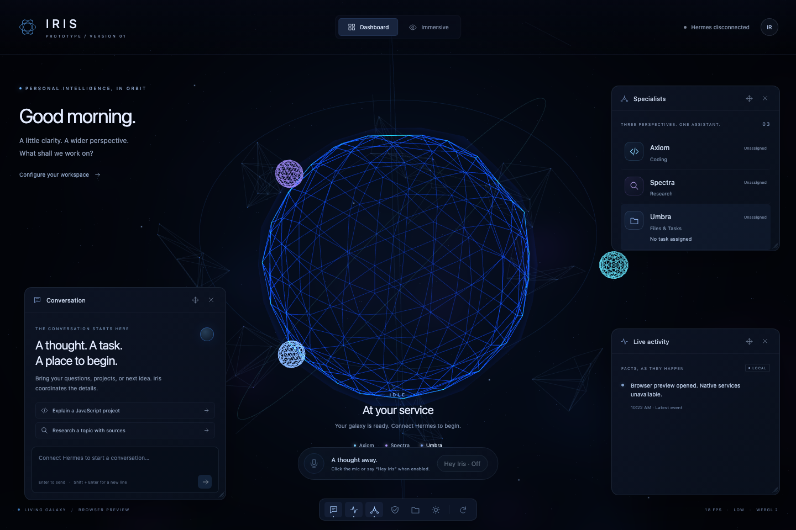
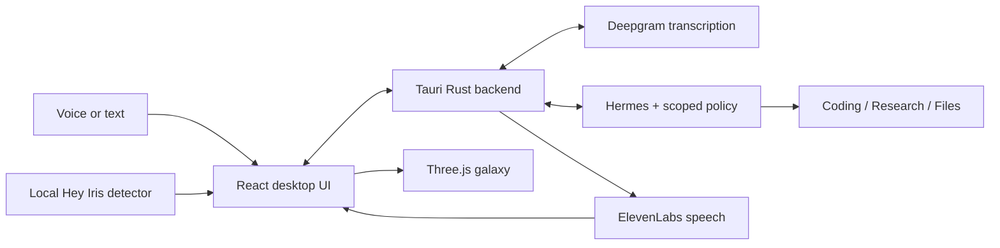

# Iris Prototype

A voice-first desktop assistant that brings conversation, scoped AI specialists, and a reactive galaxy interface into one workspace.

Built by **Akai Outlaw** as a software engineering portfolio project and an early step toward Iris: a personal AI coordinator that helps with coding, research, and everyday project work.

**Status:** working local prototype · **Native target:** Apple Silicon macOS 13+ · **Browser preview:** interface and labeled demo only



## What it does

- **Talk naturally.** Activate the mic or say **“Hey Iris,”** wait for **Listening**, speak, and pause. About 1.2 seconds of silence submits the command; Iris speaks her reply. Wake listening pauses during replies and requires an explicit opt-in each launch.
- **See assistant state.** A Three.js galaxy responds to actual microphone and playback audio, with distinct idle, arming, listening, processing, speaking, and error states.
- **Delegate bounded work.** Axiom handles coding, Spectra handles research, and Umbra handles files and tasks through the Hermes runtime. Their display names are editable.
- **Keep control of access.** Choose a project folder and exact research domains. Proposed file writes and supported coding checks require approval of the specific action.
- **Arrange your workspace.** Switch between dashboard and immersive views. Move, resize, close, and restore panels; retain layout and conversation locally if desired.

## Stack and architecture

| Layer                   | Technology                          | Responsibility                                                |
| ----------------------- | ----------------------------------- | ------------------------------------------------------------- |
| Interface               | React, TypeScript, Vite             | Conversation, widgets, settings, approvals                    |
| Visual engine           | Three.js, GLSL                      | Single WebGL context, galaxy layers, reactive orb             |
| Trusted desktop backend | Tauri, Rust, SQLite, macOS Keychain | Credentials, persistence, process ownership, audio transports |
| Wake detection          | Swift, Apple Speech, AVAudioEngine  | On-device English phrase recognition                          |
| Agent runtime           | Python, Hermes                      | Coordinator and three scoped specialist surfaces              |
| Speech services         | Deepgram, ElevenLabs                | Streaming transcription and generated voice                   |



## Try the interface without accounts

Requires Node **24.21.0+** and npm. No model or speech credentials are needed for the preview.

```sh
git clone https://github.com/Akai-Outlaw/iris-prototype.git
cd iris-prototype
npm ci
npm run dev
```

Open **http://127.0.0.1:1420**. Native connections and credential entry are disabled in a regular browser. Add `?demo=1` for the explicitly labeled state demonstration. Open `?demo=1&freeze=1` for a still frame.

## Run the native assistant

The native build currently targets **Apple Silicon Macs**. Install:

1. Apple Command Line Tools: `xcode-select --install`.
2. Node 24.21.0+ and npm.
3. Rust via [rustup](https://rustup.rs/). The repository pins Rust 1.100.0 in `rust-toolchain.toml`.
4. [Hermes](https://github.com/NousResearch/hermes-agent), authenticated and configured with a model. The tested adapter targets **Hermes v0.23.1** and expects its launcher at `~/.local/bin/hermes`.

```sh
npm ci
npm run desktop
```

The build script uses standard Cargo from your PATH. An existing project-local toolchain is also supported, but `.toolchains` is neither required in a fresh clone nor committed.

In the app:

1. Open **Settings** and connect your configured Hermes provider or existing ChatGPT sign-in supported by Hermes. Authentication stays with Hermes; Iris does not include an account or bypass provider access requirements.
2. Enter your own **Deepgram** and **ElevenLabs** API keys under **Voice providers**. They are saved in **macOS Keychain**. Never put keys in source files or `VITE_*` variables.
3. Select an ElevenLabs voice, or enter a voice ID, and audition it. Speech generation requires Text to Speech access; browsing voices also needs Voices read permission. Voices, API access, and service limits depend on your account.
4. Enable **Hey Iris** and allow macOS microphone and speech permissions. On-device English speech support is required. Wait for **Listening** before speaking your command; audio during the wake-to-command handoff is not buffered.
5. For tool work, select a project folder and explicitly approve research domains. Review requested actions in the approvals panel.

Build a local app with:

```sh
npm run package
```

The locally signed bundle is created at `apps/desktop/src-tauri/target/release/bundle/macos/Iris Prototype.app`. This is a development build; public notarization and updates are not implemented.

## Development and verification

```sh
npm test              # TypeScript contracts, audio lifecycle, state and math
npm run build         # Type-check and production UI bundle
npm run test:policy   # Python scope, approval, path and dispatch tests
npm run native:check  # Native backend compile check (Apple Silicon Mac)
npm run native:test   # Rust speech transport tests
npm run test:wake     # Compiled native matcher; does not activate a microphone
npm run test:browser  # Browser interactions; requires a running preview and Chromium
```

Install the test browser with `npx playwright install chromium`. Start `npm run dev` in a second terminal before browser tests. CI runs the frontend and isolated policy checks without credentials. Physical audio and provider tests are recorded separately in [verification](docs/verification.md).

## Project map

```text
apps/desktop/src/             React UI, audio capture/playback, application state
apps/desktop/src-tauri/src/   Rust backend, speech transports, native wake bridge
native/WakeListener.swift    On-device phrase detection
packages/contracts/          Validated events and state definitions
packages/design-tokens/      Visual state targets and theme
packages/galaxy-engine/      Three.js renderer and shaders
services/iris-runtime/       Hermes adapter and execution policy
scripts/                     Build and verification tools
tests/                       TypeScript and Python tests
```

## Prototype boundaries

- The Hermes adapter uses version-sensitive execution hooks. Different Hermes versions need revalidation.
- Research fetches explicit HTTPS URLs on approved exact domains; there is no configured general search engine.
- File tools list/read text and propose approved creates/overwrites. Automatic moves, deletes, directory creation, and batch reorganization are not implemented.
- Approved coding checks are limited to `npm test`, `npm run build`, and `git diff --check` under a macOS sandbox.
- Wake detection is speech-based keyword matching. Device switching, noisy rooms, sustained battery/performance behavior, and comprehensive accessibility remain acceptance work.
- Windows/Linux native packaging, notarization, and automatic updates are outside this prototype.

See [architecture](docs/architecture.md), [security](SECURITY.md), [roadmap](ROADMAP.md), and [contribution notes](CONTRIBUTING.md). Third-party notices are listed in [THIRD_PARTY_NOTICES.md](THIRD_PARTY_NOTICES.md). A license for original project code has not yet been selected.
